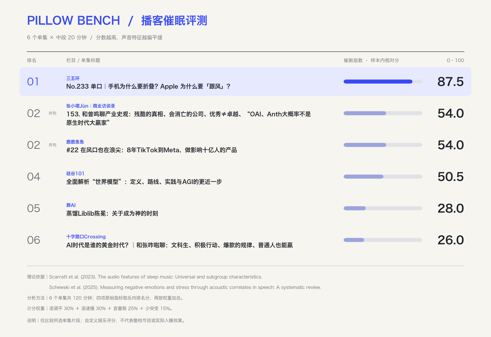
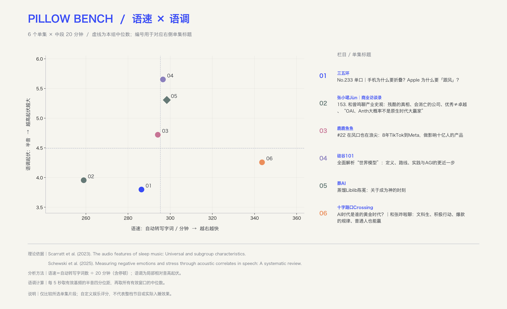
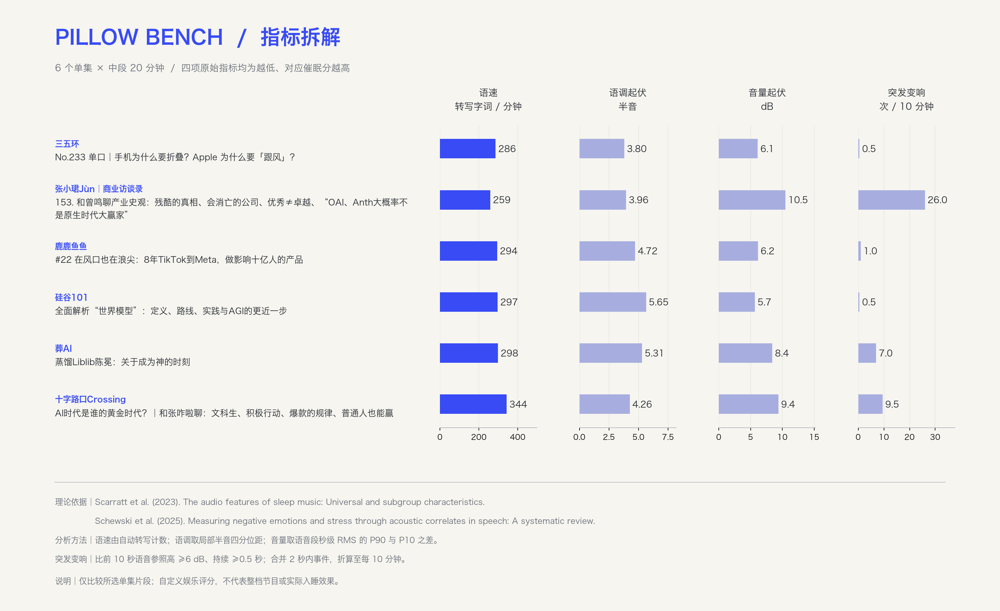

# 六个单集 · v0.2 示例

每集取中间连续 20 分钟。仅包含汇总指标和图表，不包含音频、转写片段或本机来源元数据。

| ID | 栏目 | 完整单集名 | 分数 |
|---|---|---|---:|
| s02 | 三五环 | No.233 单口｜手机为什么要折叠？Apple 为什么要「跟风」？ | 87.5 |
| s04 | 张小珺Jùn｜商业访谈录 | 153. 和曾鸣聊产业史观：残酷的真相、会消亡的公司、优秀≠卓越、“OAI、Anth大概率不是原生时代大赢家” | 54.0 |
| s05 | 鹿鹿鱼鱼 | #22 在风口也在浪尖：8年TikTok到Meta，做影响十亿人的产品 | 54.0 |
| s03 | 硅谷101 | 全面解析“世界模型”：定义、路线、实践与AGI的更近一步 | 50.5 |
| s06 | 葬AI | 蒸馏Liblib陈冕：关于成为神的时刻 | 28.0 |
| s01 | 十字路口Crossing | AI时代是谁的黄金时代？｜和张咋啦聊：文科生、积极行动、爆款的规律、普通人也能赢 | 26.0 |

## 查看图表

## 结果边界

图中的“突发变响”只表示相对近期语音的局部音量抬升，不等于爆响或惊醒次数。重叠窗口可能把短重音计为事件；尚未用主观听感校准。分数是六个指定片段之间的相对排名分，不是整档节目评分。

[汇总 CSV](metrics.csv) · [汇总 JSON](results.json) · [方法说明](../../method-v0.1.md) · [使用说明](../../README.md)

运行 `python3 scripts/verify_example.py` 可在没有音频与模型的条件下核对计分。完整声学计算仍需要自行提供原音频；公开示例无法验证转写内容或识别准确率。
